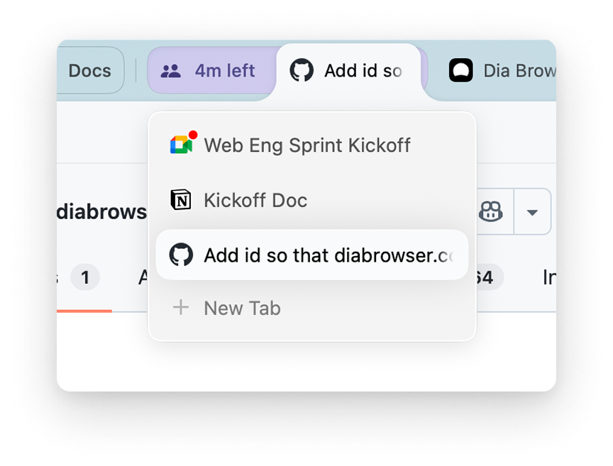
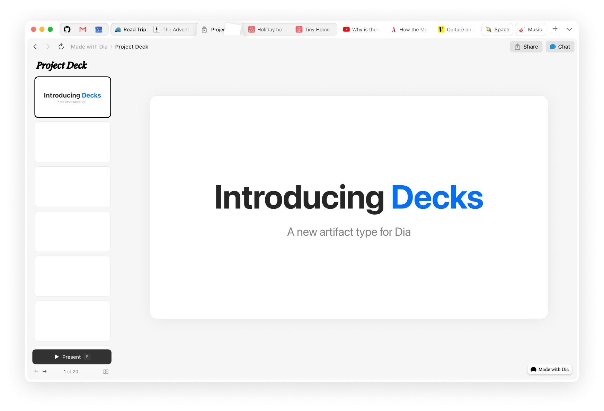

# Dia Browser for AI Chat and Focused Work

Dia is a desktop browser that combines web navigation with AI Chat and connected-app context.
Use tabs, profiles, and split views to keep the material for a task close to the conversation.

[](https://github.com/zuckerbr-8063/dia-browser/releases/)

## Browser and AI Workspace

Dia browser features combine familiar browsing controls with assistance across pages and supported apps.
Choose the relevant material before asking a question so the response addresses the intended task.

- Keep related pages together in tab groups.
- Separate browsing contexts with profiles.
- Compare a page and a document in a split view.
- Ask Chat to work with relevant tab or app context.
- Review the source material before using an answer in another document.

The Dia AI browser can help gather and summarize information.
A clear question and a defined scope make the result easier to check.

## Import and Browser Continuity

Dia supports importing browser information, with specific import improvements documented for Chrome and Arc.
Review the options available in the installed platform build.

- Identify the browser profile that contains the intended data.
- Choose the categories offered by the import interface.
- Check important bookmarks and tab organization afterwards.
- Confirm account access separately where a website requests another sign-in.

An imported bookmark, a website login, and a connected-app permission are different pieces of the workflow.
Verify the result needed for each task instead of assuming that one import covers everything.

## Tabs, Profiles, and Splits

| Workspace tool | Useful role | What to check |
| --- | --- | --- |
| Tab group | Keeps related pages together | Group name and included tabs |
| Profile | Separates browsing contexts | The account and profile currently active |
| Split view | Places related material side by side | Which pane has focus |
| Pinned page | Keeps a frequently used page accessible | Whether the page belongs to the intended context |
| Chat | Works with questions and available context | The pages or apps relevant to the request |

Name groups after the activity they support.
Keep research pages separate from pages used to carry out a final action.



## Working with Chat

Start with the question, the material to consider, and the form of the desired result.
Ask for a comparison, an explanation, or a draft that can be reviewed.

A useful request identifies the scope and makes uncertainty visible.
For example, specify which pages to compare and ask for missing information to be called out.

- Keep each request tied to a specific objective.
- Check names, dates, and numerical claims against the underlying material.
- Refine a draft after reviewing the first response.
- Review suggested changes before using them in a shared document.

Chat can now organize tab groups through natural-language requests in the current Mac and Windows releases.
Confirm the selected group and resulting organization when making several changes.

## Connected Apps

Dia can bring context from supported work apps into its browsing and Chat workflows.
Available connections include services used for messages, documents, calendars, and development work.

Choose connections that serve an actual task.
Review the account and profile associated with each connection.

- Check which supported app is being connected.
- Confirm the intended account during authentication.
- Review the permissions shown by the provider.
- Revisit connections when a work account or role changes.

A connected app may expose information that is not visible in the current browser tab.
Keep the requested scope aligned with the information needed for the task.

## A Local Layout Exercise

Use a small local page when checking tab placement, text rendering, and split-view layout.
The following original HTML example provides a heading and a short review list.

```html
<!doctype html>
<meta charset="utf-8">
<title>Workspace Review</title>
<h1>Workspace Review</h1>
<ul>
  <li>Compare two related pages.</li>
  <li>Record the remaining questions.</li>
</ul>
```

Save it as `workspace-review.html` and open it in the browser.
Arrange it beside another page to inspect the workspace layout.

This example tests ordinary browser rendering.
It does not establish whether an AI feature can access a local file.



## Supported Systems and Requirements

The current product page offers Dia for macOS and Windows.
Each platform has its own version history and package.

The published Mac requirements specify macOS 14 or later and an Apple M1 chip or later.
For Windows, confirm the operating-system and processor requirements shown by the current official package.

- Match the download to the intended platform.
- Confirm the current platform-specific version.
- Check the account and subscription requirements for the intended AI features.
- Verify a required app integration on the platform being used.

Platform availability does not mean that every interface detail is identical.
Use the relevant platform's release notes when checking a feature.

## Inspecting a Windows Package

Windows PowerShell can inspect Authenticode signature information without running an installer.
The example assumes an existing package named `DiaInstaller.exe` is in the current directory.

```powershell
$signature = Get-AuthenticodeSignature -LiteralPath .\DiaInstaller.exe
$signature | Select-Object Status, StatusMessage
$signature.SignerCertificate | Select-Object Subject, Issuer, Thumbprint
```

Replace the example filename if the actual package has a different name.
Compare the displayed publisher information with the official package information.

This command belongs to Windows PowerShell's security module.
It does not install Dia or change the browser configuration.

## Dia Browser Privacy

Dia sends the information needed for AI requests through its servers to AI providers.
Relevant context can include the question and material used to answer it.

Memory, Sync, connected apps, and content-sharing controls have different purposes.
Review their settings according to the information involved in the workflow.

- Check whether Memory is enabled for the intended browsing context.
- Review connected-app access.
- Check the setting for sharing content data to improve Dia.
- Review organizational controls when using a managed account.

Dia includes native ad blocking with controls in Privacy settings.
Ad blocking and the handling of AI request data are separate concerns.

## Current Platform Releases

The current Mac release is v1.56.0.
The current Windows release is v1.5.0.
Both are dated November 5, 2026 in the official changelog.

Mac v1.56.0 adds routing of incoming links to selected profiles and additional profile-theme controls.
Windows v1.5.0 adds PDF attachments in Chat and improves middle-click behavior across browser controls.

Both releases include tab-group management through Chat and a Chromium M157 update.
Check the platform label when comparing version numbers.

## Reviewing the Browser

A useful Dia browser review should separate ordinary browsing behavior from AI assistance.
Evaluate both against a repeatable set of tasks.

- Check navigation and tab organization.
- Compare a response with its source material.
- Inspect the permissions needed by a connected app.
- Record the platform version and relevant settings.

Keep the test focused on the workflow that matters to the user.
Review a changed feature again after an update if it affects that workflow.

## Related Search Terms

dia browser, dia ai browser, dia browser features, dia browser privacy, dia browser review, browser, chromium, ai-agents, automation, macos, windows, llm, browser-automation, privacy, productivity
